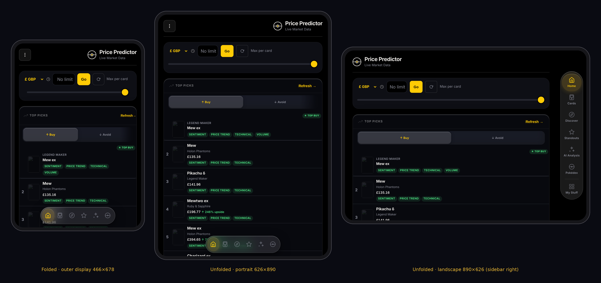

# iOS app

## Price Predictor (the app) — `PricePredictor.xcodeproj`

A native shell around the live website. Every feature is the site's own code,
loaded from `https://simont90.github.io/pokemon-price-predictor/`, so a push to
`main` reaches the app on its next launch with **no rebuild**. Rebuild only when
something under `ios/PricePredictor/` changes.

```
PricePredictor.xcodeproj      # committed; open this. No xcodegen needed.
PricePredictor-Info.plist     # WKAppBoundDomains + launch colour (merged with generated keys)
PricePredictor/               # synchronised folder: any file added here joins the target
  PricePredictorApp.swift
  ContentView.swift           # web view, load bar, first-launch offline screen
  WebViewModel.swift          # everything a browser does that WKWebView doesn't
  WebViewRepresentable.swift
  Assets.xcassets             # icon (from icons/icon-512.png), accent, launch colour
```

What the shell supplies, because WKWebView does not do it on its own:

- **alert / confirm / prompt.** Without a `WKUIDelegate` they silently do
  nothing — `confirm()` returns false and `prompt()` returns null, so naming a
  group or confirming a delete would quietly fail.
- **Downloads.** The JSON backup export (`a.download` on a blob URL) goes to
  the share sheet: Save to Files, AirDrop, Mail.
- **External links.** eBay, Collectr, PriceCharting etc. open in Safari, or in
  their own app via Universal Links. Pages of the site itself stay in-app.
- **Offline.** `WKAppBoundDomains` = `simont90.github.io` is what lets `sw.js`
  run inside WKWebView, so after one online launch the app opens offline with
  the full catalogue, same as the Home Screen web app.
- **Background kills.** iOS reclaims the web process when the app is
  backgrounded; `webViewWebContentProcessDidTerminate` reloads instead of
  leaving a blank screen.
- Safe areas are the site's own `env(safe-area-inset-*)` padding
  (`viewport-fit=cover`), so the scroll view's automatic insets are off.
- The user agent carries `PricePredictorApp/1.0` if the site ever needs to
  tell it is in the app.

**Storage is the app's own.** WKWebView's localStorage is separate from
Safari's, so the app starts with an empty collection. Pair it to sync with the
same pair code (Sync settings) and the collection arrives from `/sync`.

### iPhone Duo

The app is built for the foldable as well as regular iPhones:

- **Build with Xcode 27.1 (iOS 27.1 SDK).** Older SDKs run on the Duo but
  letterbox: the iOS 27 SDK stops short of the status-bar area on the inner
  display, and only 27.1 goes edge to edge.
- **Every pose is just a width to the site.** Outer ≈ 466×678pt, inner
  ≈ 626×890pt (pixel specs at 3×), Split View on the inner display down to
  ~296pt. The site's CSS breakpoints handle each one: bottom pill folded and
  in inner portrait, the vertical sidebar in inner landscape (≥821pt).
- **Navigation lives in the status-bar column.** On both Duo displays the
  status bar sits in a column down one side, beside the camera, and Apple's
  guidance is that vertical controls lay out in that column directly under
  it. CSS can see the column (the side safe-area inset) but not where the
  status bar ends, so `ChromeAwareWebView` reports every geometry change and
  `pushStatusBarGeometry()` sets `html[data-status-bar="right"|"left"|"top"]`
  and `--status-bar-bottom`. With a side status bar the site turns the bottom
  pill (folded) and the sidebar (unfolded) into one vertical rail centred in
  that column, and page content runs right up to it. Other iPhones report
  `top`; Safari reports nothing; both are unchanged.
- **First launch is slow; later ones aren't.** The first load fetches ~4.5 MB
  (~1.1 MB compressed: app.js, the 26k-card catalogue, CSS) and parses it —
  about 1–3 s of script on a fast CPU before Home renders, on top of a cold
  simulator. After that sw.js serves the files from cache.
- **The sidebar follows the system's vertical-bar side.** Apple's guidance:
  vertical bars lay out under the status bar, beside the camera (the right
  by default), "can appear on the left side in landscape and Split View",
  and apps must handle either side. On touch screens the sidebar is on the
  right; `initNavSide()` in app.js moves it left when the left safe-area
  inset is the larger one. Mouse-driven desktop keeps it on the left.
  Folding and unfolding resize the web view in place — no reload, state kept.
- **Asymmetric safe areas.** The camera puts the inset on one side only.
  `contentInsetAdjustmentBehavior = .never` passes each edge to CSS as its
  own `env(safe-area-inset-*)`, and every piece of fixed chrome (sidebar,
  filter button, AI button, toasts) offsets by its own side.
- **Inner display ignores supported orientations**, so nothing in the shell
  or the site branches on orientation or device type — only on width.
  Portrait upside-down is enabled for the outer display.
- **Split View is supported** (`UIRequiresFullScreen` is deliberately not
  set). Dialogs present from the web view's own window, so they land on the
  right scene when the app is beside another app or on either display.



*Headless browser render at Duo sizes (dark mode, buster `20261031b`) — not the iOS simulator; card art blocked in that environment.*

Checked in a cloud session by rendering the site headless at every Duo size
(outer/inner × portrait/landscape, ½ and ⅓ Split View) with the camera inset
simulated on each side: no horizontal page overflow, nothing under the camera.
**Not yet checked on the Duo simulator or a real Duo** — do that in Xcode:
Device Hub → iPhone Duo simulator → open, close, rotate, fold; drag the app
to each side for Split View.

### Build and run (Mac mini, free Apple ID)

1. Clone fresh: `git clone https://github.com/simont90/pokemon-price-predictor`
2. Open `ios/PricePredictor.xcodeproj` in **Xcode 27.1 or later**.
3. Target → Signing & Capabilities → Team: pick your Apple ID (Personal Team).
   If the bundle id `com.simontariq.pokepredictor` is refused, change it to
   anything unique.
4. Plug in the iPhone, choose it as the run destination, ⌘R.
5. First run only: on the iPhone, Settings → General → VPN & Device
   Management → trust your developer certificate. Developer Mode must be on
   (Settings → Privacy & Security → Developer Mode).

Free-account signing expires after **7 days**; the app then won't open until
it is run from Xcode again. The Apple Developer Program (£79/yr) lifts that
and enables TestFlight.

Debugging: Safari on the Mac → Develop → <iPhone> → Price Predictor gives the
web inspector on the running app (`isInspectable`).

Not verified from a cloud session: this was written in a Linux container with
no Xcode, so the first build on the Mac is the first compile. The project file
parses and every object reference resolves; anything else surfaces there.

---

## Native SwiftUI client — `PokePredictor/` (paused)

Kept for reference; the web shell above is the app. It shares the bundle id,
so only one of the two can be installed at a time.

A native SwiftUI client for the same backend the web app uses. **Not buildable
on this Mac yet** — see Blockers.

## What exists

`PokePredictorKit/` — a Swift package holding the data layer. Foundation only,
no SwiftUI and no UIKit, so it builds with Command Line Tools alone and the
Xcode app target later just imports it.

- `SyncSnapshot.swift` — decodes the `/sync` blob. The envelope is
  `{ "data": { key: "<raw JSON string>" }, "ts": n }`: every value is a *string*
  holding JSON, because the web client writes `localStorage` verbatim. Keys are
  decoded on demand so one malformed key never costs the others, and
  `pkm-binder-sort-v1` (the bare string `dex`, not valid JSON) does not throw —
  that exact parse threw in the web client and silently skipped the key.
- `WorkerClient.swift` — `/health`, `GET/PUT /sync`. Holds no API secrets: the
  worker owns every third-party key. The pair code is a credential and belongs
  in the Keychain, which is the app target's job, not the kit's.
- `Tests/` and `Sources/KitCheck` — the same assertions twice, once under
  XCTest and once as a plain executable, so the layer stays verifiable even
  without a full Xcode install.

**Verified:** one clean `swift build` of the library. The tests and `KitCheck`
have **not been run** — the toolchain is licence-blocked (below).

## Building and running

```bash
ios/build.sh                      # defaults to "iPhone 18 Pro Max"
ios/build.sh "iPhone 17 Pro Max"
cd ios/PokePredictorKit && swift test
```

**Do not use `xcodebuild` on this machine.** It deadlocks on Xcode's
`IDEContainer` uniquing lock before compiling anything — zero object files
after 17 minutes, reproduced both with and without the SwiftPM dependency, and
`xcodebuild -list` hangs on the project too. `swiftc` builds the same sources
in seconds, so `build.sh` compiles the binary and assembles the `.app` bundle
by hand. The `.xcodeproj` is still generated by `xcodegen generate` for editing
in the Xcode GUI.

Two smaller traps: codesign refuses any bundle carrying extended attributes
(`xattr -cr` first, which `build.sh` does), and the kit's sources are compiled
straight into the app rather than linked as a package.

## What works

Verified running on the iPhone 18 Pro Max simulator (iOS 27.1): 27,085 cards load from the bundle, search by
name / set / number, card art (both image hosts), GBP-first prices, card detail,
and the sync tab reading the shared `/sync` blob. `swift test` passes 7 tests
covering the blob's decoding edge cases.

## The valuation model is not ported — it is the same code

`ModelBridge.swift` runs **app.js verbatim inside JavaScriptCore**. The model is
never translated to Swift, so the phone cannot disagree with the website about
what a card is worth. A Swift reimplementation would have been a third copy
(the worker already carries a divergent second one with FX hardcoded at 0.79).

`Resources/` is generated on every build by `tools/make-resources.py`, which
copies `app.js` and the three data files straight from the repo root. Nothing
is hand-maintained, so the two cannot drift.

Three things make it work headless, all in `prelude.js`:

- **JavaScriptCore has no DOM.** app.js gets a Proxy-based `document`, `window`
  and `localStorage` — enough to parse and define its functions.
- **JavaScriptCore has no timers and no `queueMicrotask`.** Without them app.js
  throws partway through *evaluation*, every `const` after that point stays in
  the temporal dead zone, and the first call fails with a baffling "cannot
  access COLLECTR_TRUSTED_MAX_GRADE before initialization". The model is
  synchronous, so deferred work simply never runs — intended, not a gap.
- **`init()` still fails, and that is fine.** It wires the whole browser UI.
  `bridge.js` decodes the catalogue itself with app.js's own `decodeCardDB` and
  calls only the model. `getCardById` returns null headless for the same reason
  — its index is built in `init()` — so the bridge falls through to the
  catalogue rather than treating that null as "no such card".

### What this means for the numbers

The model is identical; the **inputs** are not yet. The website prices cards
from PriceCharting and Collectr live, while the app currently has only the
catalogue price, so the PSA rungs come back `estimated` and the figures sit
below the website's. Estimated rows are never medalled — that rule is the
model's, not the app's — which is why Gold currently lands on Buy Raw rather
than a PSA rung. Wiring the worker's live prices into the bridge is the next
step and needs no model changes.

## Not ported yet

Binder pages, marketplace scan, eBay watch, Standouts, Vintage, Sets, Budget,
the grade calculator and the price charts. The bridge makes each of them a
rendering job rather than a reimplementation.
